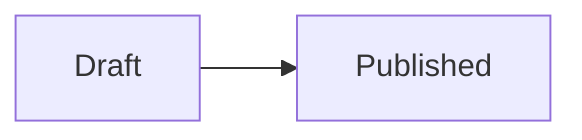

# Content reference

The paths below use `content/` as the content directory. See the [README](../README.md#content) to use a different directory for local work.

## Pages

Use `content/<name>/<name>.md` for each page. Add a `title` and a root-relative `permalink` to the YAML front matter. End the permalink with `/`. The generator uses the permalink as the page route. Use a different route for each page.

The navigation lists `home`, `writing`, `book-shelf`, and `projects`, in that order. Use `permalink: /` in `content/home/home.md`. Its `title` sets the home page heading and the site title. The `writing` and `book-shelf` pages introduce their lists.

## Posts, newsletters, and books

Put posts in `content/writing/posts/`. Put newsletters in `content/writing/newsletter/`. Add a `title` and a `date` in `YYYY-MM-DD` format to each file. The generator publishes entries by default. Set `published: false` to exclude an entry. The generator uses the `writing` page permalink and the file name for each entry. Use a different file name for each entry across the two directories.

Put books in `content/book-shelf/books/`. Add a `title`, an `author`, and a `date` in `YYYY-MM-DD` format to each file. The book shelf lists the most recent books first. For books with the same date, it sorts them by title. The page does not show dates before 2019.

## Raw Markdown and static files

Set `render: raw` in the front matter of a Markdown file in the content root. The generator copies the file body to the site root without changes. It does not copy the front matter. For example, `content/resume.md` becomes `/resume.md`.

Put static files in `public/`. For example, `public/assets/photo.jpg` becomes `/assets/photo.jpg`. The generator trusts Markdown and any HTML in it.

## Comments

Use `%% ... %%` for Obsidian comments. The generator removes comments from Markdown when it makes HTML. The build fails if a comment has no end marker. The generator keeps comment markers in code examples and in files with `render: raw`.

## Links and font options

If an entry has a `substack` URL, its list link opens that URL in a new tab. Add `?local` to the page URL to use the local entry page instead. Internal links keep this parameter. Without JavaScript, the list link opens the Substack URL. If an entry has no `substack` URL, its list link always opens its local page.

By default, absolute HTTP and HTTPS links and protocol-relative links have an icon and open in a new tab. This includes links to the site's own domain. If a link specifies a target, the browser uses that target.

Geist Serif is the default font. Add `?font=baskerville`, `?font=geist`, or `?font=times` to a page URL to select a font. Internal links keep this parameter. This option requires JavaScript.

## Mermaid diagrams

Use a `mermaid` code fence in a Markdown page or post:

````markdown

````

The browser loads [Pele](https://pele.run/) only on pages with Mermaid blocks. Diagrams fit the available width and use the site colors. If JavaScript is off or a diagram fails to appear, the browser shows the diagram source.

The site uses Pele 1.13.0 from `public/vendor/pele/1.13.0/`. To update Pele, run `npm pack pele@<version>`. Copy `dist/pele.js` and `LICENSE` to the new version directory. Update the paths in `public/mermaid.js` and `main_test.go`.

## Search metadata

Set `description` in the front matter of a page or post. If the field is empty or absent, the generator uses the first paragraph that contains text. If neither is available, the generator does not add a meta description.

Set `domain` in `site.yaml` to the site hostname without a scheme or path. The generator uses HTTPS with this domain for canonical links and `/sitemap.xml`.

The sitemap lists published local pages and posts. It does not list entries with a `substack` URL, drafts, raw files, or assets. The generator does not set a canonical link for entries with a `substack` URL. The site does not yet have an index policy for these entries. Submit the sitemap URL to Google Search Console after deployment.
